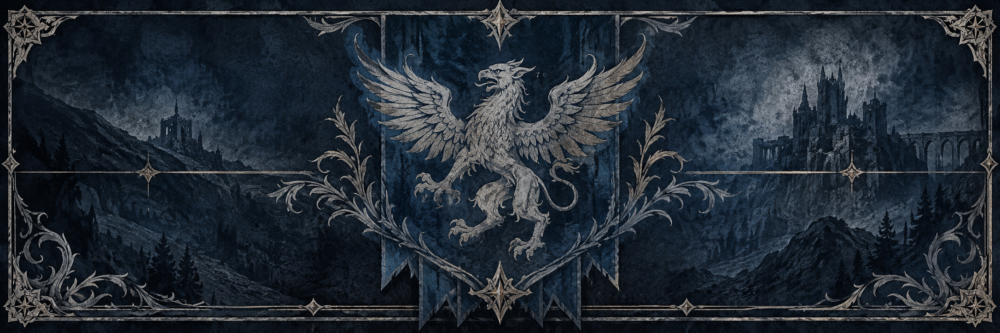

 

# 99-040 | 21st-Century IT Skills

### FIRST SEMESTER · 2026 · PORTFOLIO_MENDOZA

---

## I · ABOUT 

THE ARCHIVE

This repository documents my coursework, activities, and examinations for **99-040: 21st-Century IT Skills**.

The archive contains work involving digital design, personal branding, documentation, presentations, artificial intelligence, web development, and professional materials.

> A record of work completed, knowledge acquired, and skills developed throughout the semester.

---

## II · ABOUT ME

PERSONAL RECORD

<table align="center">
<tr>
<td width="35%" align="center" valign="middle">

# LANCE A. MENDOZA

**Nursing · 4th Year**

Ateneo de Davao University

**Interests**

Books · Video Games · Music

---

## III · ACQUIRED SKILLS

PROFICIENCIES &amp; TOOLS

<table align="center">
<tr>
<td width="50%" align="justify" valign="top">

### ◈ Technical Proficiencies

- Presentation design
- Personal branding
- Infographic design
- Visual communication
- Project documentation
- Group presentations
- AI-assisted tools
- Website creation
- Resume development

</td>
<td width="50%" align="center" valign="top">

### ◈ Tools &amp; Applications

  

</td>
</tr>
</table>

---

## IV · TABLE OF CONTENTS

SEMESTER RECORDS

<table align="center">
<tr>
<th width="12%" align="center">NO.</th>
<th align="center">ACTIVITY</th>
<th width="20%" align="center">RECORD</th>
</tr>

<tr>
<td align="center">01</td>
<td align="justify"><a href="./Activity-1">Presentation Design Principles</a></td>
<td align="center">FILED</td>
</tr>

<tr>
<td align="center">02</td>
<td align="justify"><a href="./Activity-2">Personal Branding</a></td>
<td align="center">FILED</td>
</tr>

<tr>
<td align="center">03</td>
<td align="justify"><a href="./Activity-3">Social Media Infographics &amp; Project Documentation</a></td>
<td align="center">FILED</td>
</tr>

<tr>
<td align="center">04</td>
<td align="justify"><a href="./Activity-4">Group Presentation and Exam</a></td>
<td align="center">FILED</td>
</tr>

<tr>
<td align="center">05</td>
<td align="justify"><a href="./Activity-5">AI Tools Activity</a></td>
<td align="center">FILED</td>
</tr>

<tr>
<td align="center">06</td>
<td align="justify"><a href="./Activity-6">Making a Website</a></td>
<td align="center">FILED</td>
</tr>

<tr>
<td align="center">07</td>
<td align="justify"><a href="./Activity-7">Resume Generating</a></td>
<td align="center">FILED</td>
</tr>
</table>

---

## V · ARCHIVE STATUS

REPOSITORY MONITOR

<table align="center">
<tr>
<th align="center">ARCHIVE COMPONENT</th>
<th align="center">CURRENT STATUS</th>
</tr>

<tr>
<td align="center">Repository</td>
<td align="center"></td>
</tr>

<tr>
<td align="center">Portfolio Access</td>
<td align="center"></td>
</tr>

<tr>
<td align="center">Coursework Records</td>
<td align="center"></td>
</tr>

<tr>
<td align="center">Semester Progress</td>
<td align="center"></td>
</tr>
</table>
