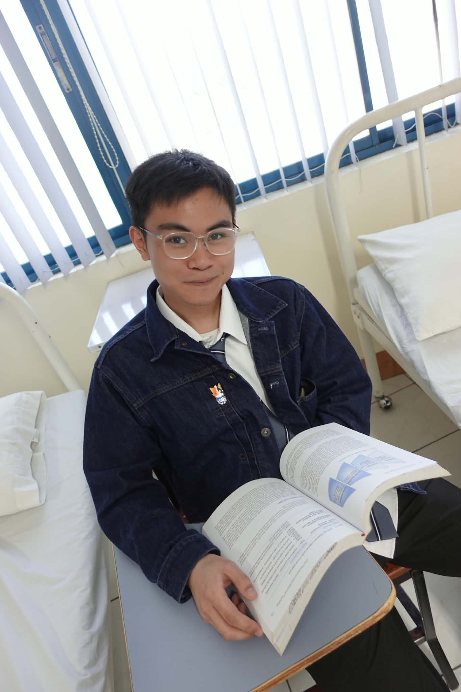

 

# 99-040 | 21st-Century IT Skills

### FIRST SEMESTER · 2026 · PORTFOLIO_MENDOZA

  

<em>Vigilance. Duty. Sacrifice.</em>

 

---

## I · REPOSITORY OVERVIEW

THE ARCHIVE

This repository documents my coursework, activities, and examinations for **99-040: 21st-Century IT Skills**.

The archive contains work involving digital design, personal branding, documentation, presentations, artificial intelligence, web development, and professional materials.

> A record of work completed, knowledge acquired, and skills developed throughout the semester.

---

## II · THE RECRUIT

PERSONAL RECORD

<table>
<tr>
<td width="35%" align="center" valign="middle">

</td>
<td width="65%" valign="middle">

### LANCE A. MENDOZA

**Nursing · 4th Year**

Ateneo de Davao University

 

INTERESTS

Books · Video Games · Music

</td>
</tr>
</table>

---

## III · ACQUIRED SKILLS

PROFICIENCIES & TOOLS

<table>
<tr>
<td width="50%" valign="top">

### ◈ Technical Proficiencies

- Presentation design
- Personal branding
- Infographic design
- Visual communication
- Project documentation
- Group presentations
- AI-assisted tools
- Website creation
- Resume development

</td>
<td width="50%" valign="top">

### ◈ Tools & Applications

  

</td>
</tr>
</table>

---

## IV · CHRONICLE OF ACTIVITIES

SEMESTER RECORDS

<table>
<tr>
<th width="12%" align="center">NO.</th>
<th align="left">ACTIVITY</th>
<th width="20%" align="center">RECORD</th>
</tr>

<tr>
<td align="center">01</td>
<td><a href="./Activity-1">Presentation Design Principles</a></td>
<td align="center">FILED</td>
</tr>

<tr>
<td align="center">02</td>
<td><a href="./Activity-2">Personal Branding</a></td>
<td align="center">FILED</td>
</tr>

<tr>
<td align="center">03</td>
<td><a href="./Activity-3">Social Media Infographics & Project Documentation</a></td>
<td align="center">FILED</td>
</tr>

<tr>
<td align="center">04</td>
<td><a href="./Activity-4">Group Presentation and Exam</a></td>
<td align="center">FILED</td>
</tr>

<tr>
<td align="center">05</td>
<td><a href="./Activity-5">AI Tools Activity</a></td>
<td align="center">FILED</td>
</tr>

<tr>
<td align="center">06</td>
<td><a href="./Activity-6">Making a Website</a></td>
<td align="center">FILED</td>
</tr>

<tr>
<td align="center">07</td>
<td><a href="./Activity-7">Resume Generating</a></td>
<td align="center">FILED</td>
</tr>
</table>

---

## V · ARCHIVE STATUS

REPOSITORY MONITOR

<table>
<tr>
<th align="left">ARCHIVE COMPONENT</th>
<th align="center">CURRENT STATUS</th>
</tr>

<tr>
<td>Repository</td>
<td align="center"></td>
</tr>

<tr>
<td>Portfolio Access</td>
<td align="center"></td>
</tr>

<tr>
<td>Coursework Records</td>
<td align="center"></td>
</tr>

<tr>
<td>Semester Progress</td>
<td align="center"></td>
</tr>
</table>

 

 

### IN PEACE, VIGILANCE.
### IN WAR, VICTORY.
### IN DEATH, SACRIFICE.

 

The work is not yet finished.

  

 

